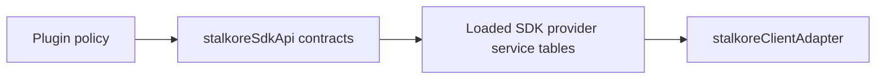

# stalkoreSdkApi

**The public contract for SDK-owned client services.**

Rust bindings and a [C header](include/stalkore_sdk_api.h) let in-process plugins
observe logical client state and request guarded operations through the loaded
SDK provider. That provider may be an embedded forwarding DLL or a separate
`sdk.dll`.
The SDK implementation and its client adapter are separate private repositories.
This repository contains no client addresses, profiles, hooks or game binaries.

| Guide | Read it to |
| --- | --- |
| [Integration](docs/integration.md) | Connect a plugin to the already loaded SDK |
| [ABI and lifetime](docs/abi.md) | Understand versions, ownership, threads and failure |
| [Client services](docs/client.md) | Use snapshots, opaque tokens and logical operations |
| [Presentation](docs/presentation.md) | Control supported window visibility on the SDK thread |
| [Frame pacing](docs/frame-pacing.md) | Apply supported frame-end limits and observe actual frame rate |
| [Process memory](docs/process-memory.md) | Inspect counters and request guarded residency reclamation |
| [Tests](docs/testing.md) | Validate the contract with synthetic providers |
| [Glossary](GLOSSARY.md) | Follow the shared architectural vocabulary |
| [Client updates](docs/client-updates.md) | Decide whether an executable update requires any public API change |

Start with the [documentation index](docs/README.md).

```rust,no_run
use stalkore_sdk_api::SdkApi;

let api = SdkApi::connect()?;
let capabilities = api.client()?.probe()?.capabilities;
# Ok::<(), stalkore_sdk_api::Error>(())
```

There is no API executable or additional runtime DLL to install. The
`stalkore-sdk-api` crate is linked into each consumer; calls go through the
versioned C tables exported by the loaded SDK. The first consumer is
[stalkoreAutoLogin](https://github.com/Stalkore/stalkoreAutoLogin).



Current runtime integration targets Windows x86. Contract and mock tests also
run without a game. Compatible runtime availability is a separate requirement.
GitHub source is public; `publish = false` keeps crates.io publication disabled.

[MIT license](LICENSE).
